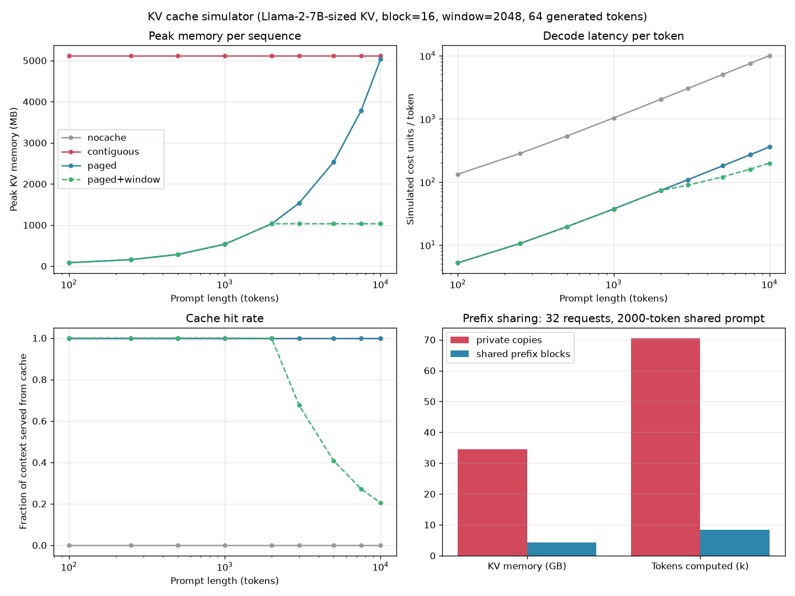

# KV Cache Simulator

A small Python simulator of how LLM inference servers manage **KV cache** memory, and how that
choice affects memory use and decode latency. It covers a vLLM-style **paged allocator**, a
**sliding-window** rolling buffer, and **prefix sharing** across requests.



## Why the KV cache matters

When a transformer generates text, each new token attends to every earlier token. Attention needs
each earlier token's **key** and **value** vectors. Without a cache, the model recomputes them for
the whole prefix at every step, so each step costs O(n). With a cache, it computes K/V once per token
and reads them back later.

The cost is memory. For a Llama-2-7B-sized model in fp16, the cache holds
`2 (K,V) × 32 layers × 32 heads × 128 dim × 2 bytes ≈ 0.5 MB` **per token**. A 10k-token
conversation needs about 5 GB of KV cache for a single request.

## What's simulated

| Strategy | How memory is held |
|---|---|
| `nocache` | Nothing kept. The full prefix is recomputed every step. |
| `contiguous` | One slab of `MAX_CONTEXT` (10,240) slots reserved per request up front, as servers did before vLLM. The final length isn't known at admission, so it reserves the maximum. |
| `paged` | A shared pool of fixed-size blocks (16 tokens). Each request has a **block table** mapping its logical blocks to physical blocks, and memory grows one block at a time. Waste is under one block per request. |
| `paged+window` | Paged, plus blocks that fall entirely outside the last `window` tokens go back to the pool (rolling buffer). Memory is bounded no matter how long generation runs. |
| prefix sharing | Requests with the same system prompt point at the **same physical blocks**, which are reference-counted and freed when the last user releases them. |

The generation loop is real: it does a prefill, then decodes token by token, and each step runs
softmax attention over K/V gathered through the block table. The tests check that paged,
contiguous and no-cache attention outputs are **identical**, so the paging is a pure memory
optimization.

## Results

`python kvsim.py` (64 generated tokens, block = 16, window = 2,048):

| Prompt | Contiguous peak / waste | Paged peak / waste | Window peak / hit rate | Latency/tok: no cache → cache |
|---:|---|---|---|---|
| 100 | 5,120 MB / 98% | 88 MB / 7% | 88 MB / 100% | 132 → 5 |
| 1,000 | 5,120 MB / 90% | 536 MB / 0.7% | 536 MB / 100% | 1,033 → 37 |
| 10,000 | 5,120 MB / 2% | 5,032 MB / 0% | 1,032 MB / 20% | 10,033 → 358 (window: 198) |

- **Caching** turns per-step cost from O(n) recompute into O(n) cheap reads, about **28× faster**
  at 10k tokens.
- **Paging** removes the over-reservation of a contiguous slab. With 80 GB of KV memory and
  request lengths uniform in 100–10,000, paged allocation fits **32 concurrent requests vs 16**.
- **Sliding window** caps memory at about 1 GB and cuts latency 45% at 10k tokens. The trade-off is
  that the model attends to only the most recent 20% of the context (quality isn't modeled here).
- **Prefix sharing**: 32 requests with a 2,000-token shared system prompt use **8.2× less KV
  memory** (4.3 GB vs 35 GB) and compute 8.4k tokens instead of 70k, with identical outputs.

In the charts, `nocache` memory overlaps `paged` (its transient per-step K/V is the same size),
and `contiguous` latency overlaps `paged` (same reads, different memory layout).

## Run it

```bash
pip install -r requirements.txt
python kvsim.py          # benchmark table, batch capacity, prefix sharing
python test_kvsim.py     # tests (also works with pytest)
python plots.py          # regenerate docs/results.png
```

`python kvsim.py --help` lists the options (`--prompts`, `--gen`, `--block-size`, `--window`).

## Simplifications (read before quoting numbers)

- **Latency is a cost model, not a measurement.** Computing one token's K/V costs 1 unit and
  reading one cached token costs 0.02 (`C_COMPUTE`, `C_READ` in `kvsim.py`). The trends are
  meaningful, but the absolute numbers aren't. Real decode is memory-bandwidth-bound, and these
  constants should be calibrated against a GPU before you rely on them.
- **One small attention head** (dim 64) is actually stored. Byte counts use the full model config.
- **Window quality isn't modeled.** Evicted tokens are dropped from attention, not recomputed.
- **Prefix sharing covers full blocks only.** The partial last block of the prefix is recomputed
  per request, so no copy-on-write is needed.
- **Batch capacity** is computed for requests admitted together. It doesn't simulate requests
  arriving and finishing over time, which is where contiguous allocation also suffers from holes
  between slabs.

## Layout

```
kvsim.py        caches, block pool, generation loop, benchmarks, CLI
test_kvsim.py   correctness tests (paged == contiguous outputs, window bounds, refcounts, ...)
plots.py        builds docs/results.png
```
